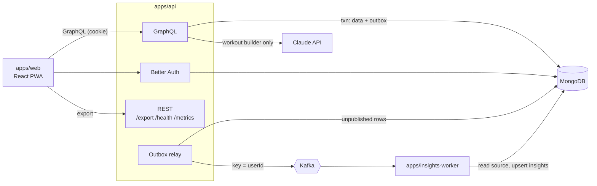
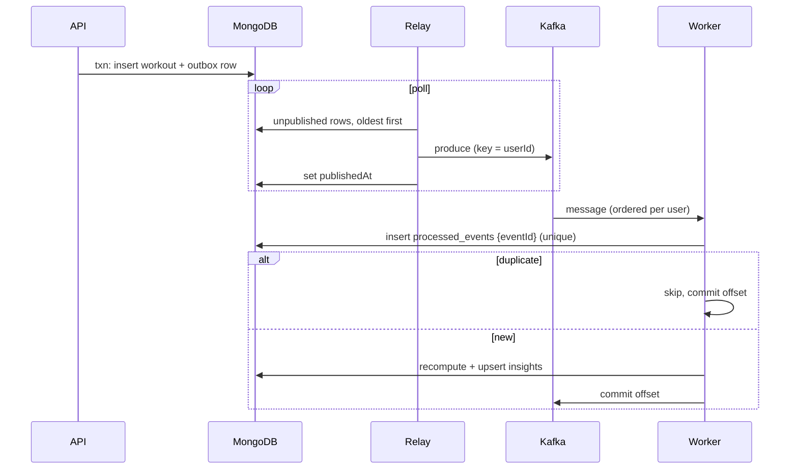

# Architecture

Decisions are recorded in [docs/adr](../adr/README.md).

## Components

| Component | Role |
|---|---|
| `apps/web` | React + Vite PWA, Apollo Client, accessible charts. |
| `apps/api` | Apollo GraphQL + Better Auth. Writes data and outbox events in one transaction. REST for `/export`, `/health`, `/metrics`. |
| outbox relay | Separate process from the api image. Publishes unpublished outbox rows to Kafka, keyed by `userId`. |
| workout generator | In `apps/api`. Calls the Claude API, which may only pick catalogue exercise IDs; a fake is used in tests. Stores nothing ([ADR-0007](../adr/0007-llm-workout-generation-claude-api.md)). |
| `apps/insights-worker` | Kafka consumer. Dedupes by `eventId`, recomputes insights from source data, handles deletion. |
| `packages/domain` | Pure logic: pace, units, phase estimation, aggregation, exercise catalogue. |
| `packages/events` | Event envelope, catalogue and topics (zod). |
| MongoDB 8 / Kafka 4 | Single-node replica set (for transactions) / single KRaft broker. |

## Event flow

**Guarantees**
- **Atomic:** data and event commit together; no dual writes.
- **At-least-once:** the relay may republish after a crash; consumers dedupe on `eventId`.
- **Ordered per user:** keyed by `userId`; the worker recomputes from current data, so replays
  converge.
- **Thin events:** IDs and metadata only, never health values.

## Data model

All times in UTC; distances in metres, durations in seconds, weights in kilograms.

| Collection | Owner | Key fields | Class |
|---|---|---|---|
| `user`, `session`, `account`, `verification` | Better Auth | email, name, credentials | Personal |
| `user_settings` | api | `units`, `cycleTrackingEnabled` | Personal |
| `workouts` | api | `kind`, `performedAt`, `rpe` 1–10, `energy?` 1–5, `notes?`; run: `distanceM`, `durationS`; strength: `exercises[{name, sets[{reps, weightKg?}]}]` | Health-adjacent |
| `cycle_entries` | api | `periodStartDate` (date only) | **Special category** |
| `consents` | api | `purpose`, `version`, `granted`, `at` (append-only) | Compliance |
| `outbox` | api | `eventId`, `type`, `payload`, `publishedAt?`, `attempts` | Operational |
| `processed_events` | worker | `eventId` (unique), TTL 30 d | Operational |
| `insights` | worker | `weekly[]`, `byPhase?`, `computedAt` | Derived health |
| `deletion_requests` | api | `status`, `requiredConsumers`, `completedBy`, TTL 30 d | Compliance |
| `deleted_users` | worker | `userId`, `at` (skip stale events) | Operational |

Pace and phase are always derived, never stored, so deleting cycle data leaves no trace on
workouts.

## Privacy design

Cycle data is GDPR Art. 9 special-category data; explicit consent is the lawful basis.

| Class | Examples | Rules |
|---|---|---|
| Special category | `cycle_entries`, `insights.byPhase` | Active consent only; deleted on withdrawal; never in logs, events or metric labels. |
| Health-adjacent | RPE, energy, notes | Never logged or in events; exported. |
| Personal | email, name | Log `userId` only. |
| AI prompt | workout-builder text | Sent only to the AI provider; never stored, logged or echoed. |
| Operational | IDs, timestamps, counts | May be logged. |

**Controls**
- **Consent:** cycle access checks the latest versioned consent, else `CONSENT_REQUIRED`.
  Withdrawal deletes cycle entries and emits `cycle.data_deleted` in one transaction.
- **Deletion:** `user.deletion_requested` reaches every store
  ([spec](../../openspec/changes/add-data-rights-and-polish/specs/account-deletion/spec.md)).
- **Logging:** pino redaction drops GraphQL variables and health fields; errors carry code and
  path only; a test enforces it.
- **Minimisation:** no birth date, location, symptoms or contraception type; no third-party
  analytics, fonts or CDNs.
- **Client:** the service worker caches the app shell only.

## Operations

- `/health` (liveness), `/health/ready` (Mongo, Kafka), `/metrics` (Prometheus, no per-user
  labels). JSON logs with `requestId`/`eventId`.
- Flags: OpenFeature file provider (`flags.json`), exposed via a `flags` query.
- Config: env vars validated with zod at startup; `.env.example` documents them.
