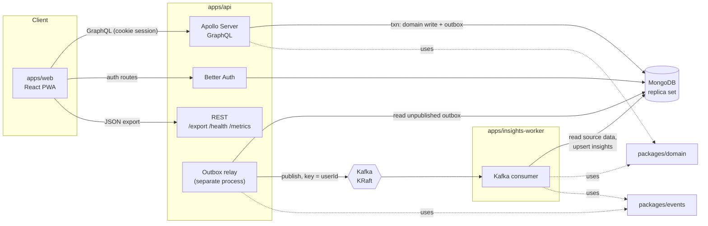
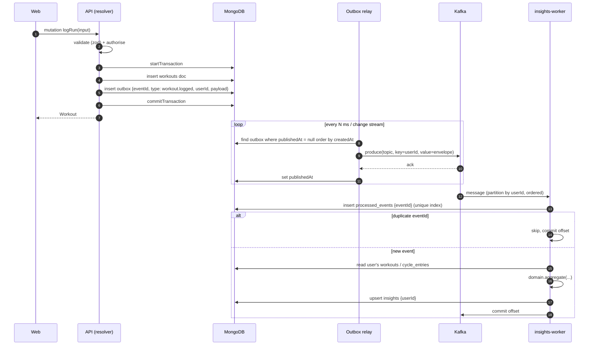

# Architecture — Cadence

Status: draft (pre-EPIC-00). Decisions referenced here are recorded in [docs/adr](../adr/README.md).

## Components

| Component | Responsibility |
|---|---|
| `apps/web` | React + Vite installable PWA. Mobile-first UI, Apollo Client, forms (react-hook-form + zod), charts (Recharts) with table alternatives. |
| `apps/api` | Apollo Server (schema-first GraphQL) and Better Auth routes. Writes domain changes and outbox events in one Mongo transaction. REST only for `GET /export`, `GET /health` and `GET /metrics`. Also hosts the **outbox relay**, a separate process entry point from the same package. |
| outbox relay | Polls/streams the `outbox` collection, publishes to Kafka keyed by `userId`, then marks rows as published. Runs as its own container (`api` image, different command) so it scales and fails independently. |
| workout generator (in `apps/api`) | `WorkoutGenerator` interface behind the `generateWorkout` mutation. The Anthropic adapter calls the Claude API with structured output, constrained to catalogue exercise IDs. A deterministic fake is used for tests and E2E. Stateless: nothing is persisted. See [ADR-0007](../adr/0007-llm-workout-generation-claude-api.md) and the [spec](../specs/ai-workout-builder.md). |
| `apps/insights-worker` | Kafka consumer. Dedupes by `eventId`, recomputes per-user insights **from source data**, and handles deletion. |
| `packages/domain` | Pure functions: pace, unit conversion, cycle-phase estimation, aggregation by phase/week, the exercise catalogue and generated-workout validation. No I/O. |
| Claude API (external) | The only external processor. It receives the workout-builder prompt text, equipment/focus/count and candidate exercise IDs, and nothing else. |
| `packages/events` | zod schemas for the event envelope and each event type, topic names and inferred TS types. The only source of truth for event contracts. |
| `packages/config` | Shared `tsconfig` bases and ESLint config. |
| MongoDB 8 | Single-node replica set (needed for multi-document transactions). |
| Kafka 4 (KRaft) | Official `apache/kafka` image, single broker locally, heap capped. |

## Event flow (transactional outbox)

### Guarantees

- **Atomicity:** a domain change and its event are committed together, or not at all. There
  are no dual writes.
- **Delivery:** at-least-once. The relay may publish a row twice if it crashes between
  `produce` and `publishedAt`. The producer runs with idempotence enabled, but consumers must
  still dedupe.
- **Idempotency:** the worker inserts `eventId` into `processed_events`, which has a unique
  index. The work and the marker are written in one Mongo transaction. A duplicate-key error
  means the event was already handled.
- **Ordering:** messages are keyed by `userId`, so all of a user's events land on one
  partition in order. The relay publishes each user's rows in `createdAt` order. The worker
  recomputes insights from **current source data**, not by applying deltas, so the result
  converges to the right answer even if events are reordered or replayed.
- **Thin events:** payloads carry IDs and non-sensitive metadata, never health values (see
  [event-pipeline spec](../specs/event-pipeline.md)). The worker reads what it needs from Mongo.

## Data model sketch

All documents carry `createdAt` and `updatedAt`, and every user-owned collection has an index
on `userId`. Distances are in metres, durations in seconds and weights in kilograms.

| Collection | Owner | Key fields | Class |
|---|---|---|---|
| `user`, `session`, `account`, `verification` | Better Auth | email, name, hashed credentials | Personal |
| `user_settings` | api | `userId`, `units` (`metric`\|`imperial`), `cycleTrackingEnabled` | Personal |
| `workouts` | api | `userId`, `kind` (`run`\|`strength`), `performedAt`, `rpe` 1–10, `energy` 1–5?, `notes?` | Health-adjacent |
|  ↳ run | | `distanceM`, `durationS` (pace derived, not stored) | |
|  ↳ strength | | `exercises[{ name, sets[{ reps, weightKg? }] }]`, `durationS?` | |
| `cycle_entries` | api | `userId`, `periodStartDate` (date only, no time) | **Special category (Art. 9)** |
| `consents` | api | `userId`, `purpose` (`cycle_tracking`), `version`, `granted` bool, `at`. Append-only. | Compliance record |
| `outbox` | api | `eventId` (uuid v7), `type`, `userId`, `payload`, `createdAt`, `publishedAt?`, `attempts` | Operational |
| `processed_events` | worker | `eventId` (unique), `userId`, `processedAt`, TTL 30 days | Operational |
| `insights` | worker | `userId` (unique), `weeklyVolume[]`, `byPhase?`, `computedAt`, `sourceEventId` | Derived health |
| `deletion_requests` | api | `requestId`, `userId`, `requestedAt`, `status`, `requiredConsumers[]`, `completedBy[]`, TTL 30 days after completion | Compliance record |
| `deleted_users` | worker | `userId`, `at`: a marker so stale events for deleted users are skipped | Operational |

Notes:
- Pace is always derived (`packages/domain`). We store the raw inputs only.
- Phase is never stored on workouts. It is computed at insight time from `cycle_entries`, so
  deleting cycle data leaves no phase residue on workouts.
- `byPhase` in `insights` is only present while cycle consent is active.

## Privacy design

Cycle data is GDPR Article 9 special-category data. Explicit consent is the lawful basis.

### Data classification

| Class | Examples | Rules |
|---|---|---|
| Special category | `cycle_entries`, `insights.byPhase` | Needs active consent. Deleted on withdrawal. Never logged, never in event payloads, never in metrics labels. |
| Health-adjacent | workout RPE, energy, notes | Never logged. Not in event payloads. Included in export. |
| Personal | email, name | Never logged in plain text (log the `userId` only). |
| Free-text AI prompt | workout-builder `prompt` | May contain anything the user types. Sent only to the AI provider. Never stored, logged, echoed in errors or put in metrics labels. |
| Operational | eventIds, timestamps, counts | May be logged. |

### Controls

- **Consent gating:** cycle mutations and `byPhase` queries check the latest `consents` record
  for `cycle_tracking` at the current consent version. If it's missing, the error code is
  `CONSENT_REQUIRED`. When the consent text changes, the version bumps and users must
  re-consent before any new cycle writes.
- **Withdrawal:** in one transaction, delete `cycle_entries`, append a `granted:false` consent
  record, and write a `cycle.data_deleted` outbox event. The worker then drops `byPhase`.
  See [cycle spec](../specs/cycle-tracking-consent.md).
- **Account deletion:** `user.deletion_requested` fans out to every consumer that holds derived
  data. See [export/deletion spec](../specs/data-export-deletion.md).
- **Logging:**
  - Redaction runs through pino `redact` paths, plus a serializer that drops GraphQL `variables`
    and resolver args entirely.
  - Errors are logged with code and path only.
  - A unit test asserts that known health fields never appear in the log output.
- **Minimisation:**
  - We don't store date of birth or location.
  - We don't store bleed length, symptoms or contraception type in the MVP.
  - There is no third-party analytics, fonts or CDNs; everything is self-hosted in the bundle.
  - The AI workout builder sends no identifiers, history or cycle data to the provider, and
    keeps no prompts or results ([spec § Privacy](../specs/ai-workout-builder.md#privacy)).
- **Client storage:** the service worker caches the app shell only. GraphQL responses holding
  health data are not persisted to Cache Storage or localStorage.

## Observability

- `GET /health`: liveness. `GET /health/ready`: readiness, pinging Mongo and the Kafka producer.
- `GET /metrics`: Prometheus format. Covers request counts and latencies by operation name, outbox
  lag (oldest unpublished age), consumer lag and processed/duplicate counts. There are **no
  per-user labels**.
- Logs are JSON (pino) with a `requestId`/`eventId` for correlation.

## Feature flags

The OpenFeature SDK uses a file-based provider that reads `flags.json`. It is evaluated server
side, and the flag values the client needs are exposed through a GraphQL `flags` query. The first
flag is `insights.enabled` (EPIC-03). `workoutBuilder.enabled` (EPIC-05) defaults to `false`.

## Configuration

All config comes from env vars, validated with zod at startup; a failure means fail fast.
`.env.example` documents every variable. It has no real secrets.
